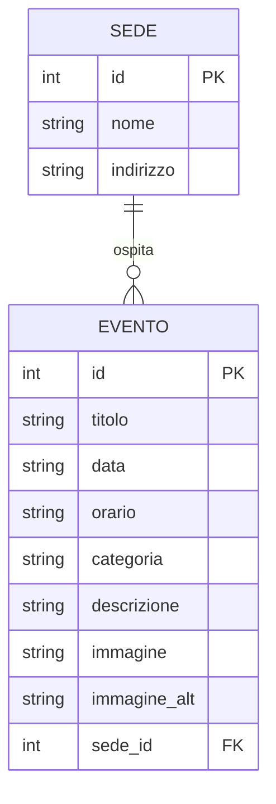

# Scheda dati — Segnale

Dati del festival Segnale (12–13 giugno, Torino), conservati in due file JSON nella cartella `dati/`:

- `eventi.json`: gli appuntamenti del programma
- `sedi.json`: i luoghi in cui si svolgono

## 1. Entità

- **Evento**: un appuntamento del festival (incontro, laboratorio o mostra).
- **Sede**: un luogo che ospita gli appuntamenti.

## 2. Campi

### Evento (`eventi.json`)

| Campo | Tipo | Esempio |
|---|---|---|
| `id` | numero intero | `1` |
| `titolo` | testo | `"Lettere in movimento"` |
| `data` | testo, formato `AAAA-MM-GG` | `"2026-06-12"` |
| `orario` | testo, formato `HH:MM` | `"10:00"` |
| `categoria` | testo (`Incontro`, `Laboratorio` o `Mostra`) | `"Incontro"` |
| `descrizione` | testo | `"Come cambia un messaggio quando cambiano le lettere? ..."` |
| `immagine` | testo (percorso del file) | `"assets/lettere-in-movimento.svg"` |
| `immagine_alt` | testo (descrizione alternativa dell'immagine) | `"Lettere geometriche disposte su una griglia"` |
| `sede_id` | numero intero (riferimento a `Sede.id`) | `1` |

### Sede (`sedi.json`)

| Campo | Tipo | Esempio |
|---|---|---|
| `id` | numero intero | `1` |
| `nome` | testo | `"Officina Nord — Sede centrale"` |
| `indirizzo` | testo | `"Corso Duca degli Abruzzi 24, Torino"` |

## 3. Chiave primaria

Per entrambe le entità la chiave primaria è `id`: un numero intero, **univoco** all'interno dell'entità e **stabile** nel tempo (una volta assegnato non cambia e non viene riutilizzato). Gli id non devono essere necessariamente consecutivi.

## 4. Relazione

Una sede può ospitare **più** eventi; ogni evento si svolge in **una sola** sede (relazione uno-a-molti).

`Evento.sede_id` fa riferimento a `Sede.id`. Nome e indirizzo della sede sono scritti solo in `sedi.json`: gli eventi li richiamano tramite `sede_id`, senza ripeterli.

## 5. Quantità

- **6 eventi** (id 1, 2, 3, 4, 5, 6)
- **3 sedi** (id 1, 2, 3)

| Sede | Eventi ospitati |
|---|---|
| 1 — Officina Nord | 1, 4 |
| 2 — Spazio Forma | 2, 5 |
| 3 — Cortile Comune | 3, 6 |

## 6. Chi aggiorna i dati e come

I dati vengono aggiornati da chi gestisce il sito, modificando direttamente i file `eventi.json` e `sedi.json` nella repository e poi pubblicando le modifiche. Non esiste un'interfaccia di amministrazione.

Regole da rispettare quando si modifica un file:

1. Mantenere un solo array `[ ... ]` per file, con gli oggetti separati da virgole.
2. Assegnare ai nuovi record un `id` mai usato prima.
3. Controllare che ogni `sede_id` corrisponda a un `id` esistente in `sedi.json`.
4. Non cambiare gli `id` già in uso, perché altri record vi fanno riferimento.

## 7. Che cosa mostra la pagina

- **Programma**: per ogni evento una scheda con immagine (e relativo testo alternativo), data, orario, categoria, titolo, descrizione e nome della sede. Il nome della sede si ricava da `sedi.json` tramite `sede_id`.
- **Info e luoghi**: le tre sedi con nome e indirizzo, in galleria fotografica, su mappa e in elenco con i link per le indicazioni.

## Schema Evento–Sede

Lettura: una **Sede** ospita zero o più **Eventi** (`||--o{`); ogni **Evento** appartiene a una e una sola **Sede** tramite `sede_id`.
